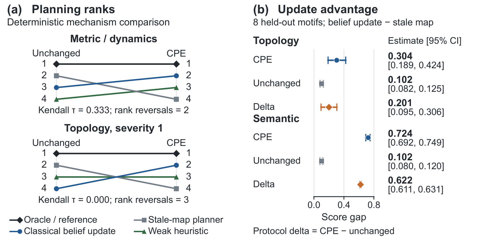

# MapShift: Controlled Post-Intervention Evaluation for Embodied World Models

Aarav Sinha · NeurIPS 2026, Evaluations and Datasets Track

[Paper (PDF)](https://aaravsinha.dev/data/mapshift-neurips-2026.pdf) · [Conference page](https://neurips.cc/virtual/2026/loc/sydney/poster/139852)

Can an agent find a detour when a familiar passage closes? In MapShift, an agent explores without reward, then faces planning, inference, or adaptation tasks after one property of the world changes. Each edited world is paired with its unchanged counterpart. This controlled post-intervention evaluation (CPE) tests changes in distance, connectivity, movement dynamics, or the meaning of cues.

## Quick start

The commands below run the MapShift-2D reference benchmark with Python 3.10 or newer. This example prints a two-room world and one edit from each of the four intervention families.

```bash
git clone https://github.com/aaravsinhaofficial/MapShift.git
cd MapShift
python3 -m venv .venv
source .venv/bin/activate
python -m pip install -e .
python scripts/smoke_map2d.py --motif two_room_connector --seed 13 --severity 2
```

The default smoke study runs a small evaluation on CPU.

```bash
python scripts/build_benchmark.py --output-dir outputs/quickstart --print-summary
```

The smoke study uses severity 0 (no change) and writes tables and figures to `outputs/quickstart/paper_outputs/`. For the full 2D experiments, see the [reproduction guide](ARTIFACT_EVALUATION.md#full-reproduction) and [technical reference](docs/README.md).

## Selected results

**MapShift-2D.** On eight held-out layouts, updating the map scored 0.102 higher than reusing it in unchanged worlds. The gap grew to **0.304** when routes changed and **0.724** when cue meanings changed. [Figure 3](https://aaravsinha.dev/data/mapshift-neurips-2026.pdf#page=7)



**ProcTHOR.** Across 371 held-out houses, local updating and reusing the old map had nearly identical navigation success when the target stayed put. After it moved, success was **64.1%** with local updating and **10.9%** with the old map, a paired gain of 53.2 percentage points (95% CI 50.1 to 56.2). Moving the target also reversed which of two map representations worked better with the same learned model and planner. [Figure 4](https://aaravsinha.dev/data/mapshift-neurips-2026.pdf#page=9)

## Citation

```bibtex
@inproceedings{sinha2026mapshift,
  author    = {Sinha, Aarav},
  title     = {{MapShift}: Controlled Post-Intervention Evaluation for Embodied World Models},
  booktitle = {Advances in Neural Information Processing Systems},
  year      = {2026},
  url       = {https://neurips.cc/virtual/2026/loc/sydney/poster/139852}
}
```

The code is licensed under [MIT](LICENSE) and generated benchmark outputs under [CC BY 4.0](THIRD_PARTY_LICENSES.md).
